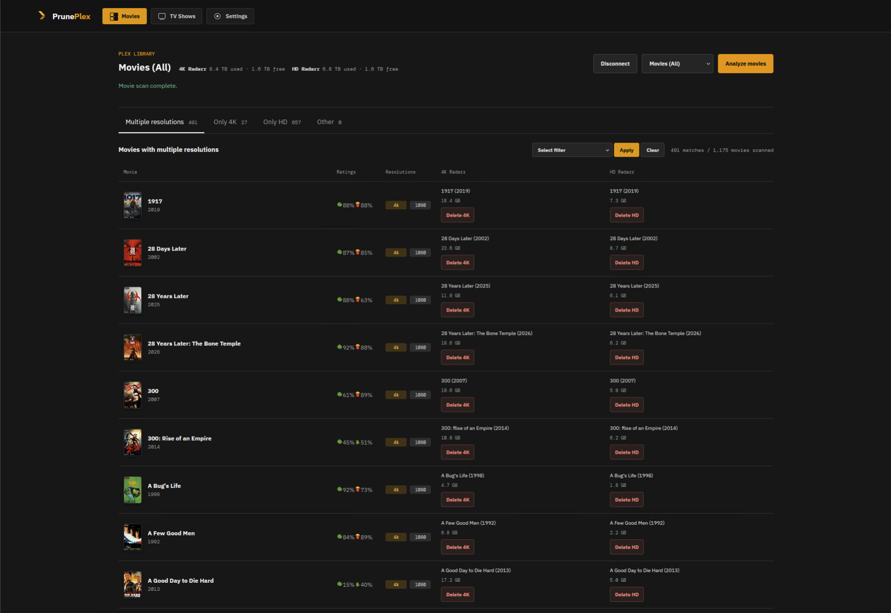
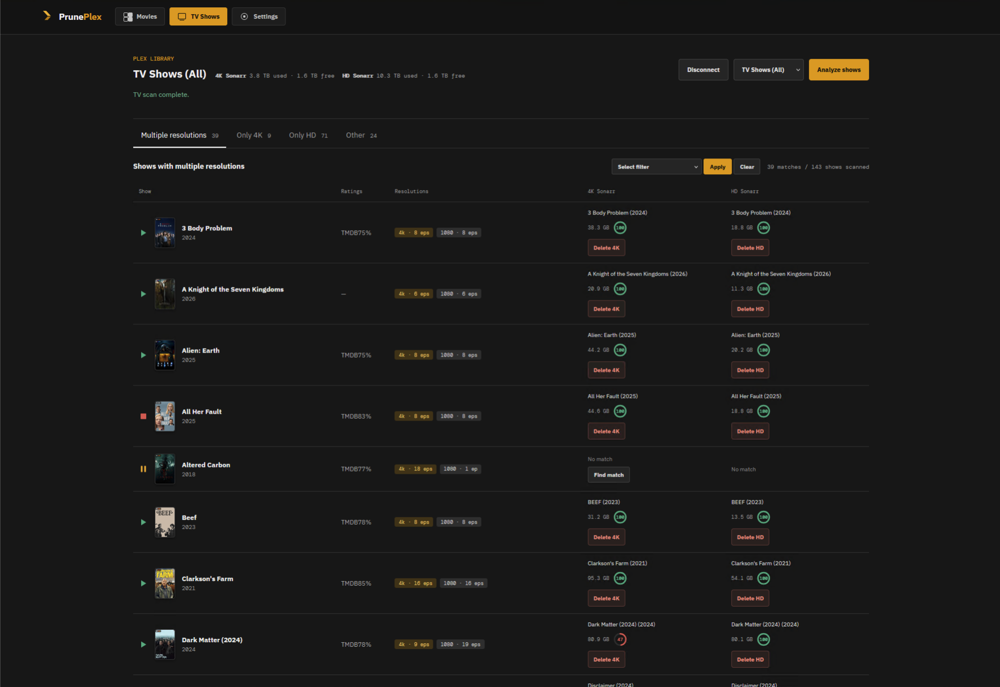
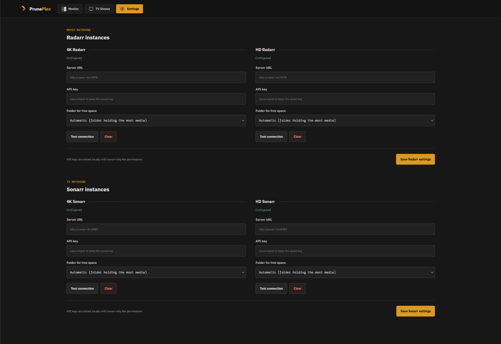

<p align="center">
  
</p>

<h1 align="center">PrunePlex</h1>

PrunePlex is for Plex libraries where **you deliberately keep more than one
resolution of some titles** (say a 4K copy *and* an HD copy so every device can
play them) but where that adds up to a lot of disk space and you want to claw
some of it back.

It finds the titles that exist in multiple resolutions, shows each copy's size
next to ratings, and lets you remove the copies you decide aren't worth keeping,
through Radarr (movies) and Sonarr (TV). Keep both versions of the titles you
love; drop the 4K or the HD copy of the ones you don't. It is a tool for trimming
a multi-resolution collection, not for wiping out titles wholesale.

It is built for the common setup of keeping separate **4K** and **HD** libraries,
each managed by its own Radarr or Sonarr instance.

## Screenshots

**Movies**: every title that exists in more than one resolution, with ratings,
per-copy sizes, delete buttons, and disk usage per Radarr instance in the header.



**TV shows**: the same view per series, with episode counts per resolution, a
status icon (▶ continuing, ■ ended, ⏸ unknown) and a completeness ring for each
Sonarr copy.



**Settings**: connect your 4K and HD Radarr and Sonarr instances and choose which
folder's free space is reported.



## What it does

1. **Connect to Plex.** Sign in with your Plex account (the standard plex.tv
   PIN flow), then pick one of your Plex Media Servers. The login is remembered
   between launches, so you only sign in again if Plex revokes the token or you
   click Disconnect.
2. **Choose a library and analyze.** A dropdown lists the server's movie
   libraries (plus "All movie libraries"). Analyzing scans the chosen library and
   sorts every movie into a tab by the resolutions Plex has for it:

   | Tab | Contains |
   | --- | --- |
   | **Multiple resolutions** | Movies that have a 4K version *and* at least one non-4K version, the prime candidates for pruning. |
   | **Only 4K** | Movies with exactly one resolution, and it is 4K. |
   | **Only HD** | Movies with exactly one resolution, and it is below 4K. |
   | **Other** | Everything else: several non-4K versions (e.g. 1080p + 720p), or a movie with a version whose resolution Plex does not report. |

   Classification uses the versions Plex stores on a single movie entry. If you
   keep HD and 4K copies in *separate* libraries, Plex lists them as two
   different entries, so each looks like a single-resolution movie. Each of the
   Only 4K / Only HD tabs shows the Radarr column for its own instance, ready for
   pruning; the Multiple resolutions and Other tabs show both.
3. **Review.** Each row shows the poster, title and year, rating badges (Rotten
   Tomatoes critic/audience, IMDb, TMDB, Metacritic and others, whatever Plex
   has), the resolutions present, and the matching movie in each configured
   Radarr instance with its size on disk. Beside the library name, the header
   totals what each configured 4K/HD Radarr (or Sonarr) instance has on disk and
   the free space of the folder holding its media (hover for the path). A match you picked by hand shows a small
   **×** next to its title to clear it again.
4. **Narrow down** (Multiple resolutions tab). Filter to the top 20% largest 4K
   or HD files, the 20% lowest-rated movies, movies where the HD file is larger
   than the 4K one, or where the 4K file is within 10% of the HD size. Pick a
   filter and click Apply; Clear shows everything again.
5. **Prune.** Each matched row has a **Delete 4K** / **Delete HD** button. It
   asks for confirmation, then tells that Radarr instance to remove the movie
   **and delete its files from disk**. This cannot be undone from PrunePlex.

### Ways to trim

The filters on the **Multiple resolutions** tab are aimed at the usual questions
about duplicates:

- *Is the 4K copy worth its space?* Apply **Top 20% 4K file size** to see the
  biggest 4K files, or **20% lowest rated** to see what you like least, and
  **Delete 4K** where the cost outweighs the quality gain.
- *Did I keep an HD copy that adds nothing?* **4K within 10% of HD size** and
  **HD larger than 4K** flag cases where the HD copy is not saving anything, so
  you can **Delete HD** and keep the better 4K file.
- *Which HD copies are the heavy ones?* **Top 20% HD file size** does the same
  for the HD side.

Every delete is individual and confirmed, and each title keeps whichever copy you
leave alone.

## TV shows

The **TV Shows** page works the same way, with a *show* as the unit instead of a
movie. Plex reports resolutions per episode, so PrunePlex combines them across
every episode of a show and sorts shows into the same four tabs: a show with
both 4K and HD episodes lands in **Multiple resolutions**; **Only 4K** and **Only
HD** need every episode at a single resolution. Resolution tags show how many
episodes have each one (e.g. `1080 · 24 eps`), and an icon left of each poster
shows whether the series is still airing according to Sonarr: ▶ continuing, ■
ended, ⏸ unknown (no Sonarr match). Next to each Sonarr size, a small ring
shows how complete the collection is: the percentage of the series' monitored,
aired episodes that Sonarr has on disk (100% means every episode). Shows are
matched to Sonarr by
TVDB, TMDB or IMDb ID, falling back to an exact title and year. If a show has no
match, **Find match** works as it does for movies (choices are saved in
`sonarr-matches.json`). **Delete** removes the whole series and all its episode
files via Sonarr.

PrunePlex never deletes anything itself or talks to Plex to delete: all
deletions go through Radarr or Sonarr, and only after you confirm.

## Setup

1. Run PrunePlex (see [Running](#running)) and open http://localhost:8081.
2. Go to **Settings** and enter the URL and API key for your 4K and/or HD Radarr
   (movies) and Sonarr (TV) instances. Without these, scanning still works but
   the Radarr/Sonarr columns show "Configure" and nothing can be deleted. Once
   an instance is saved, a **Folder for free space** picker appears under it. By
   default PrunePlex reports the free space of the root folder holding the most
   media; choose another folder there if that is not the one you care about.
3. Back on **Movies** (or **TV Shows**), click **Connect Plex**, choose your server, pick a
   library and click **Analyze movies**.

Movies are matched to Radarr automatically by TMDB/IMDb ID, falling back to an
exact title and year. If a movie shows **No match**, click **Find match**: a
shortlist of similar movies from your 4K and HD Radarr libraries appears (with
each copy's size and IDs), and a search box lets you refine it. One pick fixes
both instances at once; instances that were already matched are left alone. Your
choices are saved in `radarr-matches.json` and reused on later scans.

## Security

- PrunePlex has **no login of its own** and listens on all network interfaces
  (`:8081`). Anyone who can reach the port can use your saved Plex session and
  delete movies through your Radarr. Run it on a trusted network or behind a
  reverse proxy or firewall that restricts access.
- Your Plex token and Radarr API keys are stored in plaintext JSON
  (`plex.json`, `radarr.json`, `sonarr.json`; manual matches go in
  `radarr-matches.json` and `sonarr-matches.json`) in the config directory with owner-only
  permissions: `%AppData%\pruneplex` on Windows,
  `~/.config/pruneplex` on Linux, `~/Library/Application Support/pruneplex` on
  macOS. Set `PRUNEPLEX_CONFIG` to the path of `radarr.json` to move them
  (`plex.json` is stored alongside it).

## Building

Requires only Go (see `go.mod`). The server is pure Go with embedded assets, so
cross-compiling needs no C toolchain.

```sh
go run ./tools/build                         # all platforms -> dist/
go run ./tools/build -target host            # just this machine
go run ./tools/build -target linux/arm64,windows/amd64
go run ./tools/build -version v1.0.0 -out release
go run ./tools/build -list                   # default targets
```

Output is `dist/pruneplex-<os>-<arch>[.exe]` plus `dist/SHA256SUMS`. The same
commands work on Windows, macOS and Linux.

## Running

Download the binary for your platform from the
[Releases](https://github.com/This-will-be-your-username/pruneplex/releases)
page (or build it yourself, see above), then start it and open
http://localhost:8081. Release files are named
`pruneplex-<version>-<os>-<arch>`; locally built ones omit the version.

| Platform | `<os>-<arch>` |
| --- | --- |
| Windows (Intel/AMD, ARM) | `windows-amd64.exe`, `windows-arm64.exe` |
| macOS (Apple Silicon, Intel) | `darwin-arm64`, `darwin-amd64` |
| Linux (Intel/AMD, ARM) | `linux-amd64`, `linux-arm64` |

**Windows (PowerShell)**

```powershell
$env:PORT = "8081"   # optional, defaults to 8081
.\pruneplex-windows-amd64.exe
```

SmartScreen may warn about an unsigned download: choose *More info*, then
*Run anyway*.

**macOS**

```sh
chmod +x pruneplex-darwin-arm64
xattr -d com.apple.quarantine pruneplex-darwin-arm64   # clear Gatekeeper's block on downloads
PORT=8081 ./pruneplex-darwin-arm64                     # PORT is optional
```

**Linux**

```sh
chmod +x pruneplex-linux-amd64
PORT=8081 ./pruneplex-linux-amd64                      # PORT is optional
```

**From source (any platform with Go)**

```sh
go run ./cmd/server
```

Stop it with Ctrl+C. Settings and saved logins live in the config directory
described under [Security](#security).

## Tests

```sh
go test ./...
npm test
```

## Releases

CI (`.github/workflows/ci.yml`) runs `go vet`, the Go and JS tests, builds every
platform, verifies the checksums and smoke-tests the Linux binary on each push
and pull request. Two kinds of release are published to the
[Releases](https://github.com/This-will-be-your-username/pruneplex/releases) page:

- **`edge`**: every push to `main` replaces a rolling pre-release named *Latest
  build (edge)* with fresh binaries and `SHA256SUMS`. No tagging needed; it is
  unversioned and may be unstable.
- **Versioned releases**: pushing a tag publishes a release with generated notes.
  A tag containing a `-` (such as `v1.0.0-rc1`) is marked as a pre-release.

```sh
git tag v1.0.0 && git push origin v1.0.0
```
